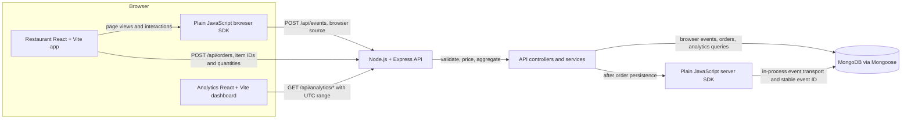

# Analytics Platform

A small, single-project web analytics platform built for a technical assessment. A restaurant demo generates anonymous browser activity and server-verified order events; an Express API validates and stores those events in MongoDB; a React dashboard reports traffic and event trends.

The project demonstrates the full event lifecycle: browser instrumentation, trusted server-side business tracking, idempotent writes, MongoDB aggregation, and a dashboard that consumes the real API. It is a local/demo system, not a hosted multi-tenant analytics product.

## Features and technology

- **Restaurant demo:** responsive React/Vite site with home, menu, cart, checkout and confirmation views. The API prices orders using server-owned menu data.
- **Browser SDK:** plain JavaScript, anonymous visitor/session IDs, SPA page views and custom events, bounded asynchronous retries.
- **Node server SDK:** plain JavaScript event helper with validation, timeout, bounded retries, stable event IDs and an in-process transport for this monolith.
- **API:** Node.js 20+, Express 4, Mongoose, MongoDB, REST/JSON.
- **Dashboard:** React 19, Vite, Recharts; summary metrics, UTC date filters, time series, popular paths, event breakdown and recent events.
- **Tests:** Vitest, Supertest, Testing Library, jsdom and `mongodb-memory-server`.

## Architecture



The server SDK transport writes to the event collection directly because the order flow and tracker run inside the same API process. The SDK also supports authenticated HTTP delivery for standalone Node services.

## Event data flow

1. The browser SDK creates a `page_view` event on initialization when enabled. The host calls `trackPageView()` after an SPA route transition. The SDK deduplicates repeated notifications for the same sanitized URL.
2. Browser interactions use `track()`, for example `menu_item_clicked`, `add_to_cart`, or `checkout_started`. Events carry anonymous IDs and page context. The ingestion route assigns `eventSource: "browser"`; the client cannot make an event trusted by setting that field.
3. The restaurant submits menu item IDs and quantities to `POST /api/orders`. The API looks up current menu prices, calculates integer minor-unit totals, and persists the order. Only after persistence does it use the server SDK to create `order_created` with `eventSource: "server"` and `eventId: "order:<orderId>"`.
4. MongoDB’s unique event ID index makes ingestion retries idempotent. Order requests also require an `Idempotency-Key`; replaying the same request returns the same order and attempts the same stable business event again.
5. The dashboard queries MongoDB aggregations through the API and renders only values returned by those endpoints.

## Repository layout

```text
.
├── dashboard/                 # React/Vite analytics dashboard, API client and UI tests
├── docs/                      # Technical design and implementation task notes
├── packages/
│   ├── browser-sdk/            # Plain JavaScript browser tracking SDK and tests
│   └── server-sdk/             # Plain JavaScript Node tracking helper and tests
├── restaurant-demo/            # React/Vite restaurant app and interaction tests
├── server/
│   ├── src/
│   │   ├── config/             # Environment and MongoDB connection
│   │   ├── constants/          # Trusted demo menu prices
│   │   ├── controllers/        # HTTP handlers
│   │   ├── middleware/         # Request IDs, rate limits, errors
│   │   ├── models/             # Mongoose event and order models
│   │   ├── routes/             # Express routes
│   │   ├── services/           # Event writes, order flow, aggregations
│   │   └── validation/         # Event, order and date-range validation
│   └── test/                   # API integration and validation tests
├── .env.example                # Safe backend environment template
├── dashboard/.env.example     # Public dashboard API URL template
├── restaurant-demo/.env.example # Public restaurant API URL template
├── package.json               # npm workspace scripts and backend dependencies
└── package-lock.json          # Reproducible dependency graph
```

## Prerequisites and local setup

- Node.js **20 or newer** and npm.
- MongoDB **6 or newer**, running locally or in a container. The default URI is `mongodb://127.0.0.1:27017/analytics_platform`.
- Network access on the first test run if `mongodb-memory-server` must download its MongoDB test binary.

### 1. Install and configure

From the repository root:

```powershell
npm ci
Copy-Item .env.example .env
```

Edit the root `.env` if your MongoDB URI or local ports differ. The checked-in `.env.example` contains a placeholder for `INTERNAL_INGESTION_KEY`, not a usable production secret. For standalone server-SDK HTTP ingestion, replace it with a randomly generated value of at least 16 characters. The restaurant’s in-process event transport does not need this key. Never copy a real key into a `VITE_*` variable.

If the workspace apps need a non-default API URL, copy their public templates and edit the base URL:

```powershell
Copy-Item restaurant-demo/.env.example restaurant-demo/.env.local
Copy-Item dashboard/.env.example dashboard/.env.local
```

Both default to `VITE_API_BASE_URL=http://localhost:3000`. This is a public URL setting and must not contain credentials.

### 2. Start MongoDB

Start your local MongoDB service, or use Docker if installed:

```sh
docker run --name analytics-mongo -p 27017:27017 -d mongo:7
```

The API connects to the MongoDB URI in the root `.env` and only starts listening after the connection succeeds. No seed step is required; browsing the restaurant demo creates event data.

### 3. Start the applications

Open a separate terminal at the repository root for each command:

```powershell
# Terminal 1: MongoDB-backed API on http://localhost:3000
npm run dev
```

```powershell
# Terminal 2: restaurant demo on http://localhost:5173
npm run dev:restaurant
```

```powershell
# Terminal 3: analytics dashboard on http://localhost:5174
npm run dev:dashboard
```

The backend’s default CORS allowlist includes `http://localhost:5173` and `http://localhost:5174`. Set `ALLOWED_ORIGINS` in the root `.env` to a comma-separated list if you use different origins. The dashboard Vite server is configured for port 5174; the restaurant uses Vite’s default port 5173.

## Environment variables

The backend loads the root `.env` through `dotenv`. See [.env.example](.env.example) for the exact variable names and local defaults.

| Variable | Purpose | Default / example |
|---|---|---|
| `NODE_ENV` | Runtime mode | `development` |
| `PORT` | API listen port | `3000` |
| `MONGODB_URI` | MongoDB connection string | Local `analytics_platform` database |
| `ALLOWED_ORIGINS` | Comma-separated CORS origins | Restaurant and dashboard local origins |
| `INTERNAL_INGESTION_KEY` | Server-only key for trusted HTTP server events | Placeholder in template; replace before use |
| `ANALYTICS_INGESTION_ENDPOINT` | Endpoint for standalone server SDK HTTP use | `http://localhost:3000/api/events` |
| `RATE_LIMIT_WINDOW_MS` | Public ingestion/order limit window | `60000` |
| `RATE_LIMIT_MAX` | Requests per IP per window (shared by event/order routes) | `120` |
| `ORDER_CURRENCY` | Currency stored with demo orders | `USD` |
| `TRUST_PROXY` | Trust one proxy hop when behind a trusted proxy | `0` |

The dashboard and restaurant use `VITE_API_BASE_URL` from their own `.env.local` files. Vite variables are shipped to the browser; only use public configuration such as an API base URL there.

## Browser SDK

The SDK is a plain JavaScript workspace package with no React dependency. In this monorepo, import it after `npm ci`:

```js
import { init, track, trackPageView } from '@analytics-platform/browser-sdk';

init({
  endpoint: 'http://localhost:3000/api/events',
  autoTrackPageViews: true
});

track('menu_item_clicked', { menuItemId: 'margherita' });
track('add_to_cart', { menuItemId: 'margherita', quantity: 1 });

// For an SPA, call after the router changes the URL. Same-URL calls are deduplicated.
trackPageView();
```

`init()` is singleton-safe. With `autoTrackPageViews: true`, it sends the initial view. Set it to `false` when the host explicitly tracks its initial route, as the restaurant app does. The SDK sends one event per request because the backend has a single-event ingestion contract. `track()` returns an event ID immediately and performs network delivery asynchronously.

The SDK generates a cryptographically random visitor ID persisted in `localStorage` and a session ID persisted in `sessionStorage`; if storage is blocked, IDs last for the SDK instance. It strips query strings and fragments from page URLs and referrers. Its generic API can form custom event names, but the API currently accepts only `page_view`, `menu_item_clicked`, `add_to_cart`, and `checkout_started` from browsers. Add an event to the backend allowlist before sending it.

This backend does not implement a public browser write key. Do not provide `writeKey`; a non-empty value is rejected. Delivery retries network failures, timeouts, 429s and 5xx responses at most twice, reusing the event ID. Permanent 4xx responses are not retried. `flush()` and `destroy()` are available; page-hide keepalive delivery is best effort and cannot confirm server receipt.

## Server SDK

The server SDK is independent of Express. HTTP mode requires a server-only write key and HTTPS outside loopback. Never put the key in a React app, browser code or a `VITE_*` variable.

```js
import { createAnalyticsClient } from '@analytics-platform/server-sdk';

const analytics = createAnalyticsClient({
  endpoint: process.env.ANALYTICS_INGESTION_ENDPOINT,
  writeKey: process.env.INTERNAL_INGESTION_KEY,
  timeoutMs: 2000,
  maxRetries: 2,
  onError: (failure) => {
    // Log only safe metadata. Do not log the event body or credentials.
    console.error(JSON.stringify({ level: 'error', message: 'analytics delivery failed', ...failure }));
  }
});

const result = await analytics.track('order_created', {
  orderId: 'order-123',
  itemCount: 2,
  totalAmount: 25.98,
  totalMinor: 2598,
  currency: 'USD'
}, {
  // Reuse stable context when retrying the same logical business event.
  eventId: 'order:order-123',
  timestamp: new Date().toISOString()
});

if (!result.ok) {
  // Delivery exhausted bounded retries; report/reconcile according to the host app.
}
await analytics.close();
```

HTTP server events use `Authorization: Bearer <writeKey>`, which the API validates before assigning `eventSource: "server"`. The restaurant backend instead supplies an in-process MongoDB transport to the same helper, avoiding an unnecessary HTTP hop and server key for its own event.

## Event contract, identity and metrics

Stored schema version 1:

| Field | Meaning |
|---|---|
| `eventId` | Unique idempotency ID; browser uses a UUID, the order event uses `order:<orderId>`. |
| `eventName` | Allowlisted event name. |
| `eventSource` | `browser` or `server`, assigned by trusted API code. |
| `timestamp` | UTC instant stored as a MongoDB Date. |
| `visitorId` | Anonymous browser ID; optional/null on server events. |
| `sessionId` | Anonymous tab/session ID; optional/null on server events. |
| `pageUrl`, `referrer` | Sanitized browser context; optional/null for server events. Query strings and fragments are stripped. |
| `properties` | Bounded scalar event properties; server order properties are derived from the persisted, priced order. |
| `schemaVersion` | Currently `1`. |

Browser requests require `eventId`, `eventName`, timestamp, visitor/session IDs, page URL and schema version. The server assigns `eventSource`. Server events require an event ID/name, UTC timestamp, schema version and valid event-specific properties; page context and anonymous IDs are optional. `order_created` includes the order ID, item count and server-calculated amount.

Visitor IDs represent a browser installation, not a person; clearing browser storage creates a new one. Session IDs use tab-scoped session storage. There is no fingerprinting, account identity stitching or collection of names, emails or payment data. Common sensitive property keys are rejected, but custom property values remain the integrator’s responsibility; do not send personal or payment information.

Dashboard definitions:

- **Page views:** browser events named `page_view` in the selected range.
- **Unique visitors:** distinct non-empty `visitorId` values among browser events across the full range. A visitor active on multiple days counts once in the total. Daily series buckets deduplicate within each UTC day.
- **Tracked events:** all browser and server event documents in range.
- **Orders created:** server `order_created` event count. This is an order-created metric, not payment confirmation.
- **Popular pages:** browser `page_view` counts grouped by normalized URL path.
- **Event breakdown:** counts grouped by event name and source.

All API timestamps are ISO 8601 with an explicit timezone and normalized to UTC. API queries use `from` inclusive and `to` exclusive (`from <= timestamp < to`). The UI date controls include both chosen UTC calendar dates by sending midnight for `from` and midnight after the chosen end date for `to`. Analytics ranges are limited to 90 days.

## API reference

Successful responses use `{ "data": ... }`; failures use `{ "error": { "code": ..., "message": ... } }`. Internal exception stacks are not returned.

### Health

`GET /api/health` returns `200` when MongoDB is connected and `503` otherwise:

```json
{ "data": { "status": "ok" } }
```

### Browser event ingestion

`POST /api/events` accepts one browser event. The API forces browser source and does not accept trusted order events from the browser.

```json
{
  "eventId": "550e8400-e29b-41d4-a716-446655440000",
  "eventName": "page_view",
  "timestamp": "2026-10-15T12:00:00.000Z",
  "visitorId": "anonymous-visitor-id",
  "sessionId": "tab-session-id",
  "pageUrl": "https://restaurant.example/menu",
  "referrer": null,
  "properties": {},
  "schemaVersion": 1
}
```

New events return `202` with `{ "data": { "eventId": "...", "status": "accepted" } }`. A duplicate event ID returns `200` with status `duplicate`. Malformed/unsupported events return `400`; a JSON body over 16 KB returns `413`; rate limiting returns `429`.

Trusted standalone server events may use the same endpoint with `Authorization: Bearer <INTERNAL_INGESTION_KEY>`. The server validates the key and server schema before assigning server source. Do not send this key from browser clients.

### Restaurant order

`POST /api/orders` requires `Idempotency-Key` (8–128 characters). The request accepts 1–20 item entries, each with a known menu ID and an integer quantity from 1 to 50, plus optional anonymous attribution IDs:

```json
{
  "items": [{ "menuItemId": "margherita", "quantity": 2 }],
  "visitorId": null,
  "sessionId": null
}
```

The endpoint rejects client-supplied prices/totals and calculates prices using [server/src/constants/menu.js](server/src/constants/menu.js) (USD minor units). A successful response is `201` and includes the persisted `orderId`, priced item lines, currency, subtotal/total minor units and creation timestamp. Replaying the same key and semantic request returns the same order; changing the request under an existing key returns `409 IDEMPOTENCY_CONFLICT`. Invalid IDs, quantities, items or missing keys return `400`.

Example `201` response (the order ID and timestamp are generated by the server):

```json
{
  "data": {
    "orderId": "generated-order-uuid",
    "status": "created",
    "items": [{ "menuItemId": "lemonade", "name": "Fresh Lemonade", "quantity": 1, "unitPriceMinor": 399, "lineTotalMinor": 399 }],
    "currency": "USD",
    "subtotalMinor": 399,
    "totalMinor": 399,
    "createdAt": "2026-10-15T12:00:00.000Z"
  }
}
```

### Analytics reads

All analytics endpoints require `from` and `to` ISO date-times with explicit timezones. `startDate` and `endDate` are accepted aliases. `from` is inclusive; `to` is exclusive.

```text
GET /api/analytics/summary?from=2026-10-01T00:00:00Z&to=2026-10-08T00:00:00Z
GET /api/analytics/timeseries?from=...&to=...&interval=day
GET /api/analytics/pages?from=...&to=...&limit=10
GET /api/analytics/events?from=...&to=...
GET /api/analytics/recent?from=...&to=...&limit=50
```

Example summary:

```json
{
  "data": {
    "range": { "from": "2026-10-01T00:00:00.000Z", "to": "2026-10-08T00:00:00.000Z" },
    "totalEvents": 120,
    "pageViews": 75,
    "uniqueVisitors": 31
  }
}
```

Timeseries uses `interval=day` by default and supports `hour`; it returns `points` with UTC `timestamp`, `totalEvents`, `pageViews` and bucket-level `uniqueVisitors`, including empty buckets. Pages returns up to 100 `{ pagePath, pageViews }` rows (default 10). Events returns `{ eventName, eventSource, count }` rows. Recent returns newest events, up to 100 (default 50), with only timestamp, event name/source, visitor ID and page URL. Invalid dates, reversed/over-90-day ranges, invalid intervals and invalid limits return `400`.

Example response shapes:

```json
{ "data": { "interval": "day", "points": [{ "timestamp": "2026-10-01T00:00:00.000Z", "totalEvents": 3, "pageViews": 2, "uniqueVisitors": 2 }] } }
{ "data": { "pages": [{ "pagePath": "/menu", "pageViews": 2 }] } }
{ "data": { "events": [{ "eventName": "page_view", "eventSource": "browser", "count": 2 }] } }
{ "data": { "events": [{ "timestamp": "2026-10-01T12:00:00.000Z", "eventName": "page_view", "eventSource": "browser", "visitorId": "anonymous-id", "pageUrl": "https://restaurant.example/menu" }] } }
```

## Validation, security and reliability

- Helmet security headers, disabled Express identification header, request IDs and Morgan request logging are enabled. Request bodies are not included in request logs.
- CORS allows configured origins (defaults to the two local Vite origins); credentials are disabled. CORS is not authentication.
- A shared IP rate limiter applies to browser event ingestion and order creation; its defaults are 120 requests per 60 seconds.
- JSON request bodies are capped at 16 KB. Event properties are scalar-only, capped at 30 keys and 4 KB, and reject common sensitive keys. Event URLs are HTTP(S), bounded and stripped of query/fragment data. Browser timestamps must be within 24 hours of API time.
- Event IDs and order idempotency keys are enforced by unique MongoDB indexes. Duplicate event inserts are handled as successful duplicates. Orders hash their semantic request to reject key reuse with changed contents.
- The server SDK times out requests, retries network/timeout/408/429/5xx failures a bounded number of times, does not retry validation responses, reuses an event ID across retries, and reports final failures through results and an optional safe logging callback. Browser retries are also bounded and non-blocking.
- The order is saved before `order_created` is sent. This is best-effort, not atomic: if event persistence fails after order persistence and the request is never replayed, the event may be absent. A transactional outbox is not implemented.
- MongoDB indexes support event identity, time, event name, source, visitors and page URLs; event retention/TTL is not configured.
- The dashboard uses Recharts 2.15.x. `npm ci` currently emits the package’s upstream notice that the Recharts 2 branch is inactive; it builds and tests here, but upgrading to Recharts 3 should be done with chart regression checks.

## Tests and builds

Run all suites from the root:

```powershell
npm test
```

The root command runs backend validation/API integration tests, browser and server SDK unit tests, restaurant interaction tests, and dashboard filtering/rendering tests. Backend integration tests start `mongodb-memory-server` and clear only their isolated collections; they do not use the development URI in `.env`.

Build both frontends:

```powershell
npm run build:restaurant
npm run build:dashboard
```

The backend runs directly through `npm run dev` (watch mode) or `npm start`. The frontends currently provide Vite development and build scripts; there is no deploy/publish script, production hosting configuration, authentication layer or deployment manifest.

### Results verified for this submission

On 2026-10-15, after a clean `npm ci`:

- `npm test`: passed, **47 tests total** (38 backend/SDK, 4 restaurant, 5 dashboard).
- `npm run build:restaurant`: passed.
- `npm run build:dashboard`: passed; Recharts and React vendor code are split into production chunks.
- `npm ls --depth=0`: workspace dependencies resolved without missing packages.
- `npm ci`: completed and reported **0 vulnerabilities**.
- Startup smoke checks: API entrypoint returned health `200` using a temporary MongoDB instance; restaurant and dashboard Vite URLs both returned `200` on ports 5173 and 5174.